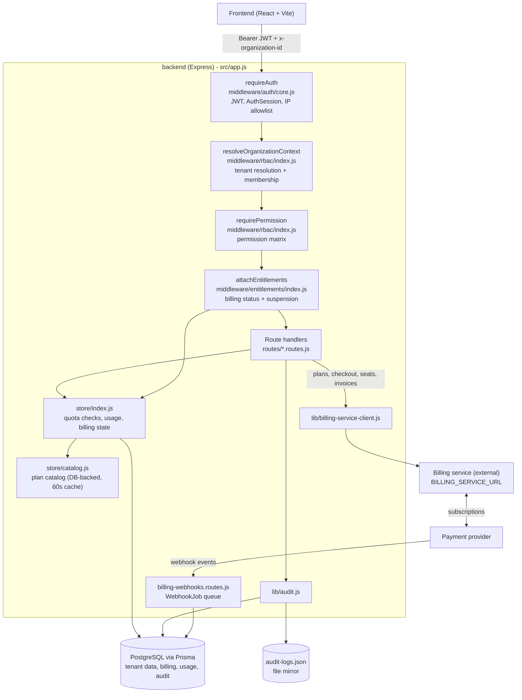
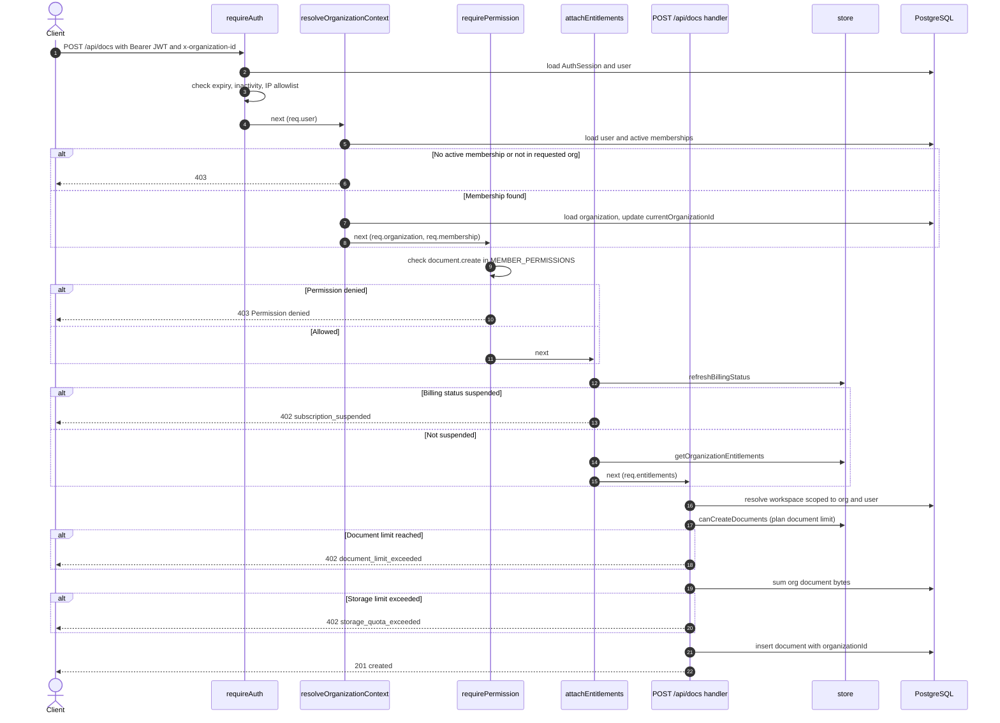
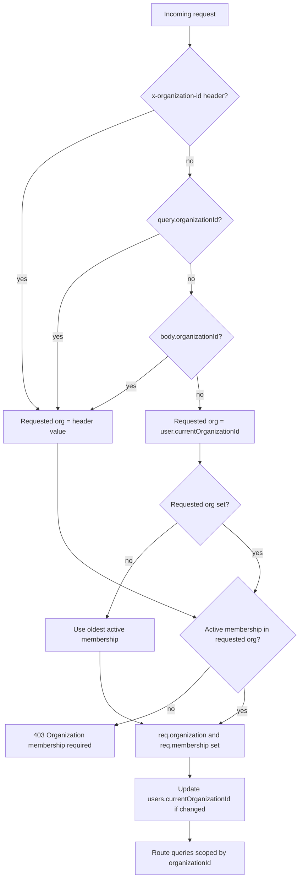
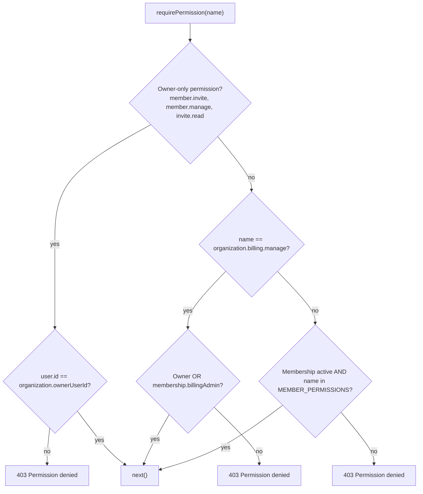
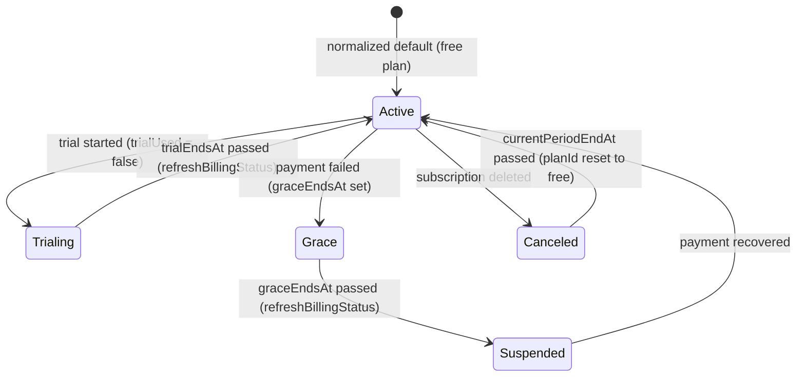
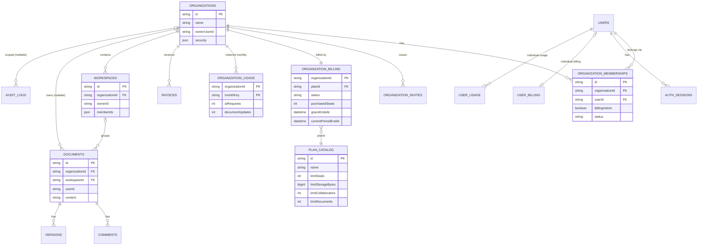

# Multitenancy, RBAC and Entitlements Architecture

Scope: the Express API in `backend/src` (Prisma + PostgreSQL). The billing service runs as a separate process (`BILLING_SERVICE_URL`) and its code is not in this workspace, so its behaviour is shown only at the integration boundary.

Diagrams use Mermaid and render in the VS Code Markdown preview (with a Mermaid extension) or on GitHub.

## 1. Component Architecture

## 2. Request Pipeline (POST /api/docs)

## 3. Multitenancy

The tenant is the **Organization**. A user can hold active memberships in several organizations (`OrganizationMembership`, unique per org and user). Every request runs in exactly one organization context.

### 3.1 Tenant Resolution

### 3.2 Tenant Isolation by Resource

| Resource | Tenant key | Isolation enforcement |
|---|---|---|
| Documents | `documents.organizationId` (nullable) | List filters `where: { organizationId }`. Detail uses `getDocForOrgDb(docId, orgId)`. |
| Comments | none on table (`comments.docId`) | Route checks `doc.organizationId === req.organization.id` first. |
| Versions | none on table (`versions.docId`) | Route checks parent document org. Restore is gated by `versionHistoryDays`. |
| Todos | `todos.organizationId` (with doc-scoped key in `todos.workspaceId`) | Route checks parent document org first, then scopes todo rows by organization and doc-scoped key. |
| Workspaces | `workspaces.organizationId` (nullable) | Docs route requires org match and user in `ownerId` or `memberIds`. The check also accepts `workspace.organizationId === userId` (personal scope). |
| Organization billing and usage | `organizationId` | Read and written only for `req.organization.id`. |
| Invoices, audit logs | `organizationId` | Scoped to the current organization. |
| Sessions, auth tokens | `userId` | User-scoped, not tenant-scoped. |

## 4. RBAC

There are no per-organization roles. Access is decided by three checks:

1. **Active membership** (`membership.status === 'active'`) grants the baseline permission set `MEMBER_PERMISSIONS`.
2. **Owner** (`organization.ownerUserId === user.id`) additionally unlocks membership management and invites.
3. **billingAdmin** flag on the membership additionally unlocks billing management.

### 4.1 Permission Matrix

| Permission | Member | billingAdmin | Owner |
|---|:---:|:---:|:---:|
| `organization.read` | Yes | Yes | Yes |
| `workspace.read/create/update/delete` | Yes | Yes | Yes |
| `document.read/create/update/delete` | Yes | Yes | Yes |
| `document.comment.read/write/delete` | Yes | Yes | Yes |
| `document.version.read/write/restore/delete` | Yes | Yes | Yes |
| `document.todo.read/write/delete` | Yes | Yes | Yes |
| `ai.use`, `grammar.use` | Yes | Yes | Yes |
| `organization.billing.manage` | No | Yes | Yes |
| `organization.member.invite` | No | No | Yes |
| `organization.member.manage` | No | No | Yes |
| `organization.invite.read` | No | No | Yes |

### 4.2 Permission Decision Flow

Deny-by-default: any permission string not in `MEMBER_PERMISSIONS` and not special-cased is rejected.

### 4.3 Membership Management

- `POST /api/organizations/current/invites` creates an invite (owner). Seat and collaborator quotas are checked here.
- `POST /api/organizations/invites/accept` accepts an invite (authenticated user). Seat and collaborator quotas are checked again.
- `PATCH /api/organizations/current/members/:membershipId` sets `billingAdmin` (owner).
- `DELETE /api/organizations/current/members/:membershipId` removes a member (owner).

## 5. Entitlements

### 5.1 Plan Source

- `PLAN_CATALOG` in [backend/src/store/catalog.js](backend/src/store/catalog.js) holds a hard-coded `free` plan as fallback.
- Other plans are loaded from the `plan_catalog` table and refreshed every 60 seconds when the database is configured.
- Trial lengths: free 0 days, starter 7, pro 14, team 14, enterprise 30.
- Each organization's current plan is stored in `organization_billing.planId`.

### 5.2 Limits and Enforcement Points

| Limit | Plan field | Enforced in | Measured as | Block response |
|---|---|---|---|---|
| Seats | `billing.purchasedSeats` | `canAssignSeats()` on invite and accept | Active memberships | Invite or accept refused |
| Collaborators | `limits.collaborators` | `canAssignCollaborators()` on invite and accept | Active memberships | Invite or accept refused |
| Total documents | `limits.documents` (null = unlimited) | `canCreateDocuments()` in `POST /api/docs` | Count of org documents | 402 `document_limit_exceeded` |
| Storage | `limits.storageBytes` | `POST /api/docs` handler | Sum of org document content bytes | 402 `storage_quota_exceeded` |
| Document updates per month | `limits.documentUpdatesPerMonth` | `canUpdateDocuments()` in `PUT /api/docs/:id` | `organization_usage.documentUpdates` | Update refused |
| AI requests per month | `limits.aiRequestsPerMonth` | `canConsumeAiRequests()` via `requireAiQuota` and `consumeAiQuota` in [backend/src/middleware/ai/entitlements.js](backend/src/middleware/ai/entitlements.js) | `organization_usage.aiRequests` | Request refused |
| Version history retention | `limits.versionHistoryDays` | `getVersionHistoryRetentionDays()` in `versions.routes.js` (list, restore, delete) | Retention window in days | Versions outside the window are not served or restored |
| AI access window | `limits.aiAccessDays` | `canConsumeAiRequests()` | Days since org `createdAt` | Request refused |
| Grammar access window | `limits.grammarAccessDays` | `requireGrammarAccess` | Days since org `createdAt` | Request refused |
| Subscription suspended | `organization_billing.status` | `attachEntitlements` | Status `suspended` | 402 `subscription_suspended` |

Usage counters are keyed by `monthKey` (`YYYY-MM`, UTC). A new month starts a new row lazily; there is no reset job.

### 5.3 Where `attachEntitlements` Is Applied

| Route | Attached |
|---|---|
| `POST`, `PUT`, `DELETE /api/docs` | Yes |
| `POST /api/workspaces` | Yes |
| `GET /api/billing/current` | Yes |
| `POST /api/grammar/check` | Yes, followed by `requireGrammarAccess` |
| `POST /api/ai/chat` | Yes, followed by `requireAiQuota` and `consumeAiQuota` |
| Reads (`GET /api/docs`, `GET /api/workspaces`, and others) | No, so suspended orgs can still read |

### 5.4 Billing Status Lifecycle

Transitions from `Trialing`, `Grace`, `Suspended`, and `Canceled` that are driven by time are enforced in `refreshBillingStatus()`. Transitions driven by provider events come from the billing service and webhook jobs, which are outside this workspace.

### 5.5 Entitlement Snapshot

`getOrganizationEntitlements()` returns `{ billing, plan, limits, usage }` where `usage` includes `assignedSeats`, `storageUsedBytes`, `collaboratorsAssigned`, `aiRequests`, and `documentUpdates`. `attachEntitlements` stores it on `req.entitlements` for the handler.

## 6. Data Model

Notes on the model:

- `Profile` (role-based flags) exists as a table but is not consulted by `requirePermission`.
- `PLAN_CATALOG` and `ORGANIZATION_BILLING` are linked by value (`planId`), not by a foreign key.

## 7. Route to Middleware Map

| Route group | Middleware chain |
|---|---|
| `GET /api/docs`, `GET /api/docs/:id` | `requireAuth`, `resolveOrganizationContext`, `requirePermission(document.read)` |
| `POST /api/docs` | Above chain with `document.create`, plus `attachEntitlements` |
| `PUT /api/docs/:id` | `document.update`, plus `attachEntitlements` |
| `DELETE /api/docs/:id` | `document.delete`, plus `attachEntitlements` |
| `/api/docs/:docId/comments` | `document.comment.*` |
| `/api/docs/:docId/versions` | `document.version.*`, retention window from plan |
| `/api/docs/:docId/todos` | `document.todo.*` |
| `/api/workspaces` | `workspace.*`, plus `attachEntitlements` on POST |
| `/api/templates` | `document.read` |
| `GET /api/organizations/current` | `organization.read` |
| `GET /api/organizations/profiles` | `organization.read` |
| `GET /api/organizations/current/entitlements` | `organization.read` |
| `GET /api/organizations/current/members` | `organization.read` |
| `GET /api/organizations/current/invites` | `organization.invite.read` (owner) |
| `POST /api/organizations/current/invites` | `organization.member.invite` (owner) |
| `PATCH`, `DELETE /api/organizations/current/members/:membershipId` | `organization.member.manage` (owner) |
| `/api/organizations/current/security/*`, `/current/audit-logs` | `organization.read` for reads, `organization.member.manage` (owner) for writes |
| `GET /api/organizations/mine`, `POST /switch`, `POST /invites/accept` | `requireAuth` only (membership-agnostic) |
| `GET /api/billing/plans`, `GET /invoices` | `organization.read` |
| `GET /api/billing/current` | `organization.read`, plus `attachEntitlements` |
| `POST /api/billing/checkout`, `POST /subscription/change`, `PATCH /seats`, `GET /webhooks/jobs` | `organization.billing.manage` (owner or billingAdmin) |
| `POST /api/billing/webhooks/provider` | None at the Express layer (public, provider callback) |
| `POST /api/ai/chat` | `ai.use`, `attachEntitlements`, `requireAiQuota`, `consumeAiQuota` |
| `POST /api/grammar/check` | `grammar.use`, `attachEntitlements`, `requireGrammarAccess` |

## 8. Observations

These came from reviewing the code while building the diagrams:

1. **Roles are binary.** Only `ownerUserId` and `billingAdmin` distinguish users. The `Profile` table and the plan flag `featureCustomRolesRbac` are not used by the RBAC middleware.
2. **Plan feature flags are not enforced.** `plan.features.*` (for example `aiAssistant`, `ssoSaml`, `auditLogs`) are defined and returned by the API, but no middleware reviewed checks them. Gating uses numeric limits and access windows instead.
3. **Seats and collaborators count the same thing.** Both use active memberships (`getCollaboratorCount` calls `getAssignedSeatCount`). Seats compare against `purchasedSeats`, collaborators against `plan.limits.collaborators`.
4. **Child tables have no tenant key.** `comments`, `versions`, and todos rely on the parent document check in each route. Any new route that skips that check would leak data across tenants.
5. **Two workspace access paths.** The docs route accepts `workspace.organizationId === userId` as well as organization match, which is a personal-scope escape hatch to review.
6. **`documents.organizationId` is nullable.** Documents without an organization are invisible to organization-scoped listing.
7. **Suspended orgs remain readable.** Reads do not attach `attachEntitlements`, so only writes and AI or grammar calls are blocked.
8. **Billing webhook route is public.** Signature or secret verification must live in the handler or billing service. It was not reviewed here, and the billing service is not in this workspace.
9. **User-scoped and organization-scoped billing coexist.** `user_billing` and `user_usage` are still used alongside `organization_billing` and `organization_usage`.
